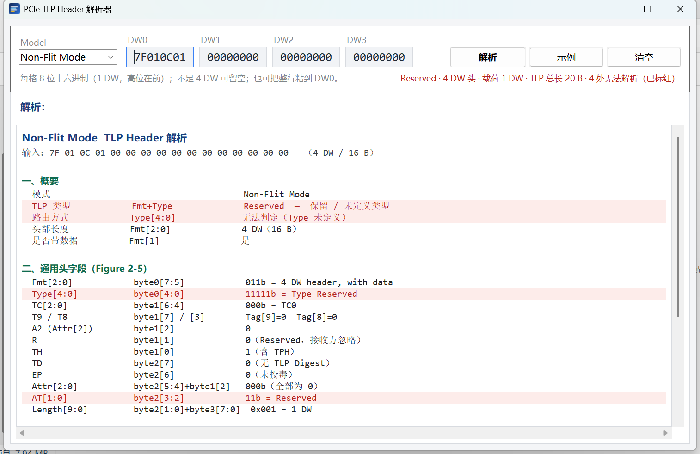
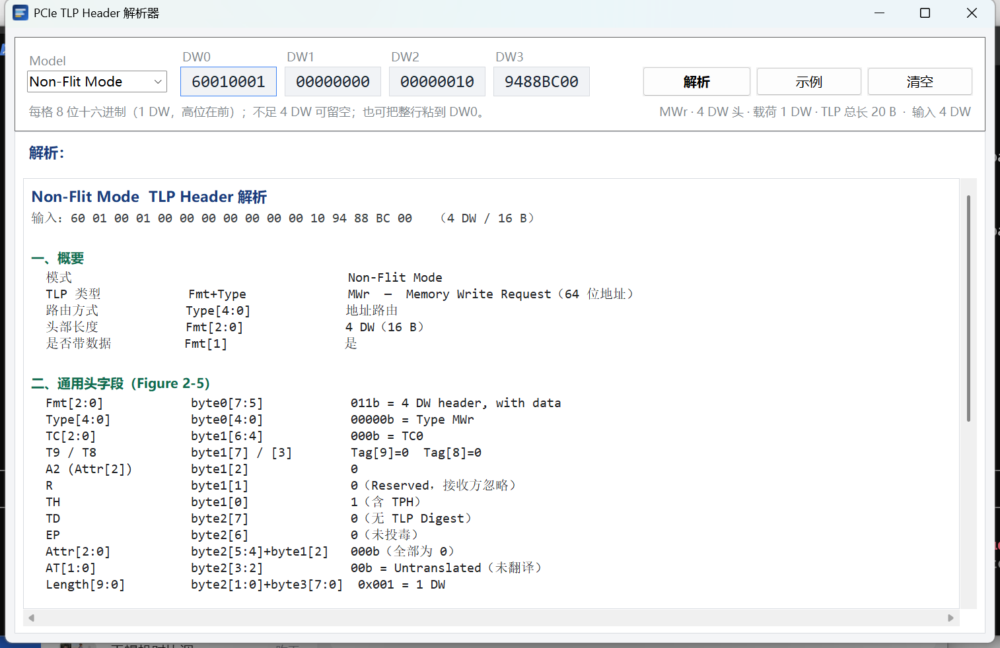
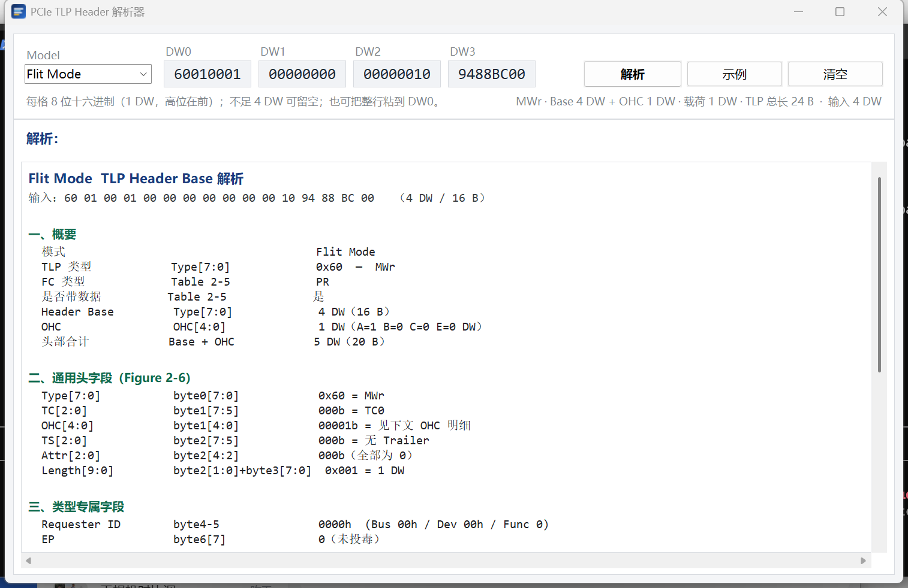
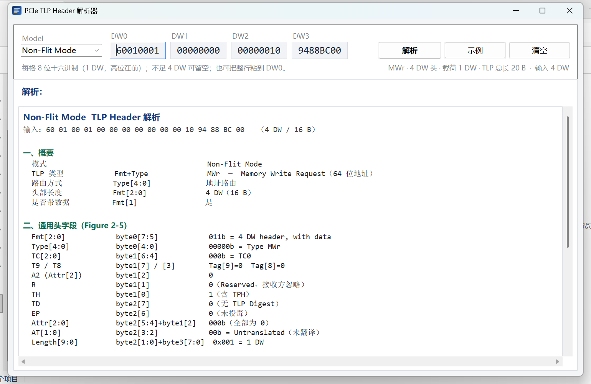

# PCIe TLP Header 解析器

一个基于 Python + tkinter 的小工具：输入一段 TLP Header（4 个 DW 的十六进制），
按 **Non-Flit Mode** 或 **Flit Mode** 解析出全部字段，给出长度统计与校验提示。

字段定义、位号与编码表均取自 *PCI Express® Base Specification Revision 7.0* §2.2.1，
整理说明见同目录的 `TLP_Header_格式解析说明.md`。

---

## 快速开始

### 方式一：直接运行 exe（无需安装 Python）

双击 `dist\PCIe_TLP_Header_Parser.exe` 即可，单文件、免安装、不依赖 Python 环境。

> 启动时会把运行时解压到临时目录，首次约 3 秒、之后约 2~3 秒。
> 若被安全软件拦截，属于 PyInstaller 单文件程序的常见误报，添加信任即可。

### 方式二：从源码运行

```bat
cd /d D:\ai_coding\pcie_tlp_anly
py -3 main.py
```

> 需要带 tkinter 的 Python 3.8+。本机 `python`（WorkBuddy 内置解释器）没有 tkinter，
> 请用系统解释器 `py -3`（Python 3.9，自带 tk 8.6）。

界面用法：

1. **Model**：选择 `Non-Flit Mode` 或 `Flit Mode`；
2. **DW0 ~ DW3**：填 4 个 DW 的十六进制，每格 1~8 位、高位在前；
   不需要 4 DW 时留空即可（例如 3 DW 头只填 DW0~DW2）；
   也可以把整行 `60010001 00000000 00000010 9488BC00` 直接粘到 DW0，会自动拆分；
3. 输入后自动解析（约 0.26 s 防抖），也可点 **解析** 或按回车；
4. 下方文本框显示：概要 / 通用头字段 / 类型专属字段 / OHC 明细 / 长度统计与校验。

### 无法解析的域段会整行标红

某个域段取到保留编码、未定义类型或查表缺失时，该行会显示为**红色文字 + 浅红底色**，
同时在右下角状态栏汇总「N 处无法解析」。目前覆盖：

| 位置 | 判定为无法解析的情形 |
|---|---|
| `Fmt[2:0]` | 101b~111b（NFM 保留编码） |
| `Type[4:0]` / `Type[7:0]` | 无对应类型，或该 Type 在当前 Fmt 下未定义（FM 的 Type 表全覆盖，主要看 NFM） |
| 路由方式 | Type 未定义，或 Message 的 `r[2:0]` 为保留值 |
| `AT[1:0]` | 11b |
| `TS[2:0]` | 查表缺失 |
| TLP Prefix | Local / End-End Prefix 的类型编码未定义 |
| `Cpl. Status` | 011b / 101b~111b |
| `HV[1:0]`（OHC-B） | 10b |
| `Sub-Stream[2:0]`（OHC-C） | 011b~110b |
| OHC-E Entry | entry 编码 > 1 |

「输入 DW 不够」这类结构性问题不算域段无法解析，仍用 `!` 开头的红色提示行表示。

下例中 `Fmt=011b / Type=11111b / AT=11b`，对应的 4 行全部标红：



内置示例：`60010001 00000000 00000010 9488BC00`
（Non-Flit Mode 下是 64 位地址的 MWr，Length = 1 DW）。

界面预览（Non-Flit Mode / Flit Mode）：





---

## 目录结构

```
pcie_tlp_anly/
├─ main.py                    程序入口
├─ run.bat                    源码运行
├─ build_exe.bat              打包脚本
├─ TLP_Header_格式解析说明.md   规范分析文档（字段位表、编码表、解析算法）
├─ tlp/                       解析核心（纯逻辑，无 UI 依赖，可单独复用）
│  ├─ bits.py                 位域读取 / 十六进制解析
│  ├─ tables.py               全部编码表（Table 2-2/2-3/2-5、TS、OHC、Prefix…）
│  └─ parser.py               两种模式的解析器 + 输出行模型
├─ ui/
│  └─ app.py                  tkinter 界面（含 DPI 感知与窗口自适应）
├─ tests/
│  └─ test_parse.py           单元测试（stdlib unittest）
├─ assets/
│  └─ app.ico                 应用图标（由 tools/make_icon.py 生成）
├─ packaging/
│  └─ version_info.txt        exe 的版本信息资源
├─ dist/
│  └─ PCIe_TLP_Header_Parser.exe   打包产物
├─ docs/                      界面截图
└─ tools/
   ├─ shot.py                 开发辅助：启动界面并自动截图
   ├─ make_icon.py            重新生成图标
   └─ verify_exe.py           打包产物自检：启动 exe → 等窗口 → 截图 → 校验
```

---

## 支持的解析能力

### Non-Flit Mode

- 前缀链（`Fmt=100b`，Local / End-End，自动剥离并识别类型）
- 通用头 4 字节全部字段：`Fmt` `Type` `TC` `T8/T9` `A2` `R` `TH` `TD` `EP` `Attr[2:0]` `AT[1:0]` `Length[9:0]`
- 类型专属字段：
  - 地址路由类请求（MRd/MWr/AtomicOp/DMWr…）：Requester ID、Tag[9:0]（含不连续的 T8/T9）、Byte Enables、32/64 位 Address、PH
  - Completion（Cpl/CplD/CplLk/CplDLk）：Completer ID、Cpl. Status、BCM、Byte Count、Requester ID、Tag、Lower Address
  - Configuration 请求：Requester ID、Tag、BE、Destination ID、Ext Reg Number、Register Number
  - Message / MsgD：Requester ID、Tag、Message Code 与路由方式
- 长度统计：Header / Payload（`Length=0` 按 1024 DW）/ TLP Digest / 总长

### Flit Mode

- Local Prefix（Type 128~143）
- Header Base 首 DW：`Type[7:0]` `TC` `OHC` `TS` `Attr[2:0]` `Length`
- Type → Header Base 长度（Table 2-5 全表，含 Reserved 区间）
- OHC 位图展开与顺序（A→B→C→E），以及各 OHC 的字段：
  - OHC-A1 / A2 / A3 / A4 / A5
  - OHC-B（Steering Tag、PH、HV、AMA、AV）
  - OHC-C（Requester Segment、PR_Sent_Counter、Stream_ID、XT、Sub-Stream、RSV、K、T）
  - OHC-E1 / E2 / E4（逐 DW 的 Entry 类型）
- Trailer 长度（`TS[2:0]` → 0~5 DW）
- 地址路由类请求的 ReqID / EP / R / Tag[13:0] / Address / AT

### 尚未展开（会在输出中提示）

Completion、Configuration、Message 在 **Flit Mode** 下的专属字段，以及 OHC 之外的
5/6/7 DW 扩展 Header Base 内部布局 —— 对应 §2.2.9 / §2.2.8 / §2.2.4.1 的
Figure 2-20 ~ 2-22，待后续补充。

---

## 用代码直接调用

```python
import sys
sys.path.insert(0, r"D:\ai_coding\pcie_tlp_anly")
from tlp.parser import parse

header = bytes.fromhex("60010001 00000000 00000010 9488BC00".replace(" ", ""))
result = parse(header, "nfm")      # "nfm" 或 "fm"
print(result.text)                 # 完整报告
print(result.summary)              # 一行摘要
```

`parse()` 的入参是字节序列，返回 `ParseResult`，其中 `lines` 是带样式的行对象，
便于在别的 UI 里复用（`kind` ∈ `title/section/kv/err/text/warn/good/blank`）。
`kind == "err"` 即“该域段无法解析”，可用 `result.error_count` 直接取数量。

---

## 测试

```bat
py -3 -m unittest discover -s tests -v
```

覆盖：NFM 的 MWr64 / CplD / 前缀 + MRd / Length=0 / Attr 位解释，
FM 的 MWr64 / OHC-A 缺失提示 / OHC-A1 解码 / NOP，
以及「无法解析」标红判定（保留 Fmt / 未定义 Type / 保留 AT / 保留 Cpl.Status / HV / OHC-E，17 例）。

---

## 打包成 exe

```bat
build_exe.bat          :: 单文件 exe  -> dist\PCIe_TLP_Header_Parser.exe
build_exe.bat dir      :: 目录版      -> dist\PCIe_TLP_Header_Parser\
```

脚本会用 `py -3`（带 tkinter 的系统 Python）调用 PyInstaller，缺失时自动 `pip install pyinstaller`。
产物特性：

| 项 | 说明 |
|---|---|
| 体积 | 约 7.9 MB（单文件，含 Python 运行时与 Tcl/Tk） |
| 依赖 | 无。目标机不需要装 Python、不需要 VC 运行库 |
| 图标 / 版本信息 | 已嵌入 `assets/app.ico` 与 `packaging/version_info.txt` |
| 启动 | 单文件模式每次解压到临时目录，约 2~3 秒；`build_exe.bat dir` 目录版约 1 秒 |
| 窗口 | 已开启 DPI 感知，150% 缩放下字体清晰不模糊；窗口按工作区（排除任务栏）自动定尺寸 |

打包后可自检：

```bat
py -3 tools/verify_exe.py out.png
```

会启动 `dist` 里的 exe、等窗口出现、截图并确认进程存活，用于回归验证。

打包产物的实际运行画面：



---

## 开发辅助

```bat
py -3 tools/shot.py out.png        :: 启动界面并截图（Non-Flit Mode）
py -3 tools/shot.py out.png fm     :: 同上，切到 Flit Mode
```

会在 `out.png`（全屏）和 `out_text.png`（文本框区域）各存一张，用于核对排版。

---

## 参考

- PCI Express Base Specification Rev 7.0，§2.2.1 Common Packet Header Fields（Page 157-176）
- Table 2-2 / 2-3 / 2-4 / 2-5 / 2-6 / 2-12 / 2-13 / 2-38 / 2-39
- Figure 2-4 ~ 2-13、Figure 2-16 ~ 2-19、Figure 2-86 ~ 2-88
